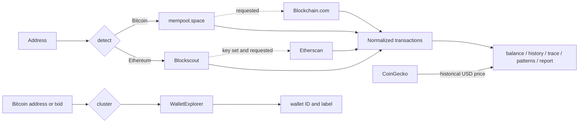

<div align="center">


<a href="#quick-start">
  
</a>

<br />


<br />


<br /><br />

**[Quick start](#quick-start)** ·
**[Configuration](#configuration)** ·
**[Commands](#commands)** ·
**[Patterns](#pattern-heuristics)** ·
**[Exit codes](#exit-codes)**

</div>

---
## Contents

- [Overview](#overview)
- [Provider flow](#provider-flow)
- [Quick start](#quick-start)
- [Configuration](#configuration)
- [Commands](#commands)
- [Pattern heuristics](#pattern-heuristics)
- [Exit codes](#exit-codes)
- [Python version](#python-version)
- [Development](#development)
- [Project layout](#project-layout)
- [License](#license)

## Overview

`ftm` follows funds on public blockchains. Given an address, it identifies the coin, reports the balance, lists recent transactions, traces outgoing funds hop by hop, flags common obfuscation and scam shapes, and writes a Markdown evidence report. Bitcoin and Ethereum are supported for analysis. Litecoin and Monero addresses are recognized by `detect` only.

Data comes from interchangeable providers. Open providers (mempool.space for Bitcoin, Blockscout for Ethereum) are the default and need no key. The `cluster` command uses the open WalletExplorer API to name the wallet cluster of a Bitcoin address or transaction. API keys are optional and enable Etherscan and CoinGecko. Blockchain.com works with or without a key.

Results are leads for manual verification. Every transaction in a report carries its hash, UTC date and source provider, so that each claim can be checked independently on a public explorer.

## Provider flow



A keyed provider is used only when requested with `--provider` (accepted by `balance`, `history`, `trace`, `patterns` and `report`) and its key is set. Blockchain.com is the exception: its key is optional, so it answers when requested even without `BLOCKCHAIN_API_KEY`, with the default limits. If the key of another keyed provider is missing and an open equivalent exists, the open provider is used and a notice is written to the error stream. CoinGecko has no open equivalent, so `balance --usd` without `COINGECKO_API_KEY` fails with a message that names the variable and how to obtain it.

The `cluster` command is separate from the other commands: it always queries WalletExplorer, takes no `--provider` option and needs no key.

## Quick start

Requirements: Python 3.15 or newer and [uv](https://docs.astral.sh/uv/), which manages the environment, execution and packaging. Installation instructions for uv are in the [uv installation guide](https://docs.astral.sh/uv/getting-started/installation/).

Windows (PowerShell):

```powershell
uv sync
uv run ftm --help
Copy-Item .env.example .env
```

Linux and macOS:

```bash
uv sync
uv run ftm --help
cp .env.example .env
```

`uv sync` downloads Python 3.15 when it is not installed. The `.env` file is optional: without it, only the open providers are used.

## Configuration

A single `.env` file in the directory where `ftm` runs holds the optional API keys. Variables already present in the process environment take precedence over the file, and empty values count as unset.

| Variable | Provider | Required |
|---|---|---|
| `ETHERSCAN_API_KEY` | Etherscan | No. Blockscout is used when absent |
| `BLOCKCHAIN_API_KEY` | Blockchain.com | No. Blockchain.com also answers without a key, with the default limits |
| `COINGECKO_API_KEY` | CoinGecko (historical prices) | Only for `balance --usd` |

The `.env` file is ignored by git. Key values are never committed, logged or printed: every URL, header and message is passed through `mask_secrets` before leaving the provider client, and the same masking applies to all command output and to reports.

### How to obtain the keys

All three keys are free, and none is required for Bitcoin or Ethereum analysis.

1. **Etherscan.** Create an account and generate a key as described in the [Etherscan key guide](https://docs.etherscan.io/getting-an-api-key). One key covers the API V2 chains available on the free plan.
2. **CoinGecko.** Create a Demo account and generate a Demo key as described in the [CoinGecko key guide](https://docs.coingecko.com/reference/setting-up-your-api-key).
3. **Blockchain.com.** Create an account and generate an Explorer API key, as described on the [Blockchain.com API plans page](https://www.blockchain.com/explorer/pricing). The key is sent in the `X-Explorer-Auth-Key` header, as documented in the [Explorer API reference](https://www.blockchain.com/explorer/docs).

Copy each value into the matching line of `.env`, with no quotes and no spaces:

```text
ETHERSCAN_API_KEY=your-value
BLOCKCHAIN_API_KEY=your-value
COINGECKO_API_KEY=your-value
```

### Provider limits

Free limits change over time. The official documentation prevails over this table, and each figure is to be rechecked before relying on it.

| Provider | Free limit | Source |
|---|---|---|
| Etherscan (API V2) | 3 calls/second and up to 100,000 calls/day, on selected chains. Requests are blocked at the daily limit. The client spaces its own requests 0.5 s apart to stay under the per-second limit | [Etherscan rate limits](https://docs.etherscan.io/resources/rate-limits) |
| Blockchain.com (Explorer API) | On 2026-11-22, the response headers reported 5 requests/second and 1,000 requests/day both without a key and with a free key. The pricing page lists 3 requests/second and 300 requests/day for the free plan | [Blockchain.com API plans](https://www.blockchain.com/explorer/pricing), [Explorer API reference](https://www.blockchain.com/explorer/docs) |
| CoinGecko (Demo plan) | 100 calls/minute. Historical data on the Basic plan is restricted to the past 2 years | [CoinGecko errors and rate limits](https://docs.coingecko.com/docs/common-errors-rate-limit), [Coin historical data](https://docs.coingecko.com/v3.0.1/reference/coins-id-history) |
| mempool.space | Public instance, no key. Limits are not published as fixed figures | [mempool.space REST API](https://mempool.space/docs/api/rest) |
| Blockscout | Public instance, no key. Limits depend on the instance | [Blockscout APIs](https://docs.blockscout.com/devs/apis) |
| WalletExplorer | Public API, no key. The documentation states no request limit today, but the service may apply limits and answer HTTP 429 | [WalletExplorer API](https://www.walletexplorer.com/api) |

When a provider answers HTTP 429 (or the Etherscan "rate limit" message), the command stops with a rate-limit error that names the provider. There is no automatic retry loop.

## Commands

```text
ftm COMMAND [ARGUMENTS]
```

Examples use the Bitcoin genesis address and a public Ethereum address. Output values below are illustrative and change with the chain state.

### detect

Identifies the coin from the address format. Works offline.

| Argument | Meaning |
|---|---|
| `address` | Address to classify (Bitcoin, Ethereum, Litecoin or Monero) |

```powershell
uv run ftm detect 1A1zP1eP5QGefi2DMPTfTL5SLmv7DivfNa
```

```text
Detected coin: Bitcoin
```

### balance

Shows the current balance.

| Argument | Meaning |
|---|---|
| `address` | Bitcoin or Ethereum address |
| `--provider NAME` | One of `mempool.space`, `blockscout`, `etherscan`, `blockchain.com`. Default: the open provider of the chain |
| `--usd` | Also shows the value in US dollars at today's price. Requires `COINGECKO_API_KEY` |

```powershell
uv run ftm balance 1A1zP1eP5QGefi2DMPTfTL5SLmv7DivfNa
uv run ftm balance 0xd8dA6BF26964aF9D7eEd9e03E53415D37aA96045 --provider etherscan --usd
```

```text
Balance: 72.30 BTC (source: mempool.space)
```

### history

Lists recent transactions, newest first, one per line: date (UTC), hash, kind, senders, total output and source.

| Argument | Meaning |
|---|---|
| `address` | Bitcoin or Ethereum address |
| `--limit N` | Maximum transactions to fetch. Default: 25 |
| `--provider NAME` | Same choices as in `balance`. Default: the open provider of the chain |

```powershell
uv run ftm history 1A1zP1eP5QGefi2DMPTfTL5SLmv7DivfNa --limit 10
uv run ftm history 0xd8dA6BF26964aF9D7eEd9e03E53415D37aA96045 --limit 10 --provider etherscan
```

On Ethereum, `kind` distinguishes native transfers, token transfers, internal transactions and contract calls.

### trace

Follows outgoing funds from the address breadth-first and prints the addresses reached with their distance and the transfers between them.

| Argument | Meaning |
|---|---|
| `address` | Origin address |
| `--hops N` | Maximum distance from the origin. Default: 3 |
| `--limit N` | Maximum transactions fetched per address. Default: 25 |
| `--provider NAME` | Same choices as in `balance`. Default: the open provider of the chain |

```powershell
uv run ftm trace 0xd8dA6BF26964aF9D7eEd9e03E53415D37aA96045 --hops 2
```

```text
Origin: 0xd8da... (ethereum), hops: 2
Addresses reached: 4
  hop 0: 0xd8da...
  hop 1: 0x...
Transfers: 3
  0xd8da... -> 0x...  1.5 ETH  2024-01-01T00:00:00Z  0x...  (blockscout)
```

Each extra hop multiplies the number of requests, so higher values consume the provider limits quickly.

### cluster

Reports the wallet cluster that a Bitcoin address or transaction belongs to, using the public [WalletExplorer API](https://www.walletexplorer.com/api). No API key and no `.env` file are needed, and any configured keys are ignored. The API covers Bitcoin only.

| Argument | Meaning |
|---|---|
| `argument` | Bitcoin address, or transaction ID (txid) of 64 hexadecimal characters, in upper or lower case |

```powershell
uv run ftm cluster 1NDyJtNTjmwk5xPNhjgAMu4HDHigtobu1s
```
```text
Type: address
Label: Binance.com
```

For a txid, the output also lists one `Output:` line per output that has a wallet, in the form `Output: ADDRESS -> wallet WALLET_ID (LABEL)`. The output carries only the `Type`, `Label` and `Output` lines. A label points to a service or cluster, not a person, and clustering is heuristic. When nothing is found, the output is `Result: no cluster found` (or `Result: transaction not found`) and the exit code is 0. A coin other than Bitcoin or an unrecognized argument exits with code 2. HTTP 429 or any other provider failure exits with code 1, without retrying.

WalletExplorer documents no request limit today, but limits may change and the service may answer HTTP 429. The official documentation prevails over this text.

### patterns

Looks for peel chains, CoinJoin transactions and address poisoning in the recent transactions of the address. See [Pattern heuristics](#pattern-heuristics).

| Argument | Meaning |
|---|---|
| `address` | Address to analyze. Also taken as the potential poisoning victim |
| `--limit N` | Maximum transactions to fetch. Default: 25 |
| `--provider NAME` | Same choices as in `balance`. Default: the open provider of the chain |

```powershell
uv run ftm patterns 0xd8dA6BF26964aF9D7eEd9e03E53415D37aA96045
```

```text
address_poisoning: 0x..., 0x...
  0x... mimics previously used address 0x... (same first 4 and last 4 characters) and sent 0 (heuristic)
```

When nothing matches, the output is `No patterns found. Results are heuristics, not proof.`

### report

Runs a trace and writes a Markdown report with an evidence table (hash, UTC date, source, note) and the pattern findings.

| Argument | Meaning |
|---|---|
| `address` | Origin address |
| `--hops N` | Maximum distance from the origin. Default: 3 |
| `--out FILE` | Writes the report to this file. Default: standard output |
| `--provider NAME` | Same choices as in `balance`. Default: the open provider of the chain |

```powershell
uv run ftm report 1A1zP1eP5QGefi2DMPTfTL5SLmv7DivfNa --hops 2 --out report.md
```

```text
Report written to report.md
```

The report layout is deterministic: the same data always yields the same text, and the evidence table can be parsed back without loss.

## Pattern heuristics

The detectors in `patterns.py` are heuristics, not proof. Legitimate activity can match these shapes, and deliberate obfuscation can be shaped to avoid them. A finding is a lead for manual verification on a public explorer.

| Pattern | Rule | Constants |
|---|---|---|
| Peel chain | At least 3 chained transactions with a single input. Each forwards a dominant output, at least 4 times the sum of the remaining outputs, and the next transaction spends it | `PEEL_CHAIN_MIN_TRANSACTIONS = 3`, `PEEL_MIN_LARGE_TO_SMALL_RATIO = 4` |
| CoinJoin | A transaction with at least 5 outputs, of which at least 3 share exactly the same non-zero value | `COINJOIN_MIN_OUTPUTS = 5`, `COINJOIN_MIN_EQUAL_OUTPUTS = 3` |
| Address poisoning | Dust (or zero-value) transfer to the analyzed address from a sender whose first 4 and last 4 characters match an earlier counterparty, but whose full address differs | `POISONING_PREFIX_LENGTH = 4`, `POISONING_SUFFIX_LENGTH = 4`, dust ceilings of 0.00001 BTC and 0.0001 ETH |

Address comparison for Ethereum ignores case and the `0x` prefix. Thresholds are named constants at the top of `patterns.py` and can be tuned there.

## Exit codes

| Code | Meaning |
|---|---|
| 0 | Success |
| 1 | Provider or configuration failure: network error, rate limit, missing key, or a report file that cannot be written |
| 2 | Invalid input: unrecognized address, bad option value, unknown provider, or a coin that is detected but not supported by the command |

Messages are written in English to the error stream, with key values masked.

## Python version

Python 3.15 is the most recent stable feature release. According to the official release schedule ([PEP 790](https://peps.python.org/pep-0790/)), 3.15.0 final was released on 2026-10-09, and the latest bugfix release listed there is 3.15.2 (2026-10-26). The schedule on python.org prevails over this text.

### Dependency compatibility

| Dependency | Role | Python 3.15 status |
|---|---|---|
| httpx | HTTP client for providers | Installs and imports on Python 3.15 |
| pytest | Test runner | Installs and imports on Python 3.15 |
| hypothesis | Property-based tests | Installs and imports on Python 3.15 |

No dependency without Python 3.15 support was found, so no alternative was adopted. Any future incompatibility is to be recorded in this table together with the alternative chosen.

The check ran `uv sync --python 3.15` on CPython 3.15.0b2, the build available to the installed uv at the time. The same check is to be repeated on the final 3.15 release.

## Development

```powershell
uv run pytest
```

Tests make no network calls.

## Project layout

```text
src/follow_the_money/             package source
src/follow_the_money/providers/   data providers
tests/                            unit and property-based tests
```

## License

Released under the MIT License. See `LICENSE`.
